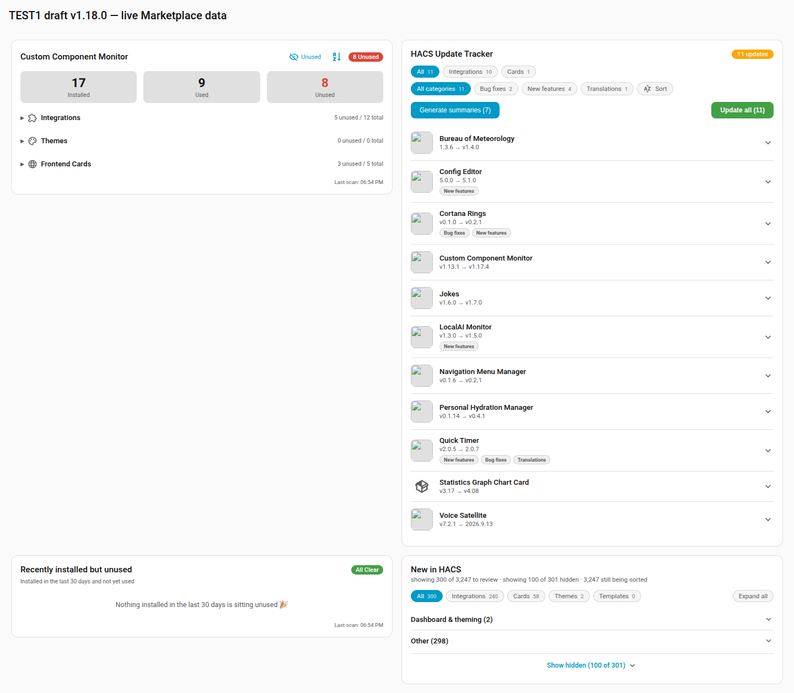
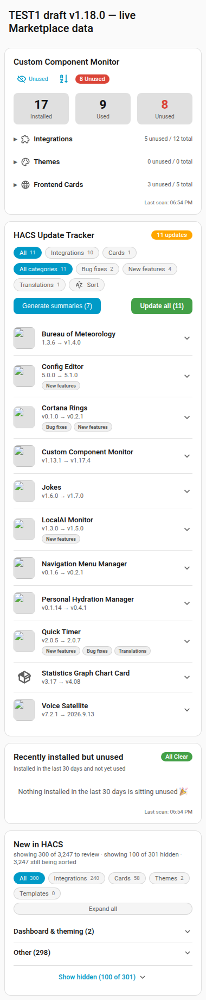
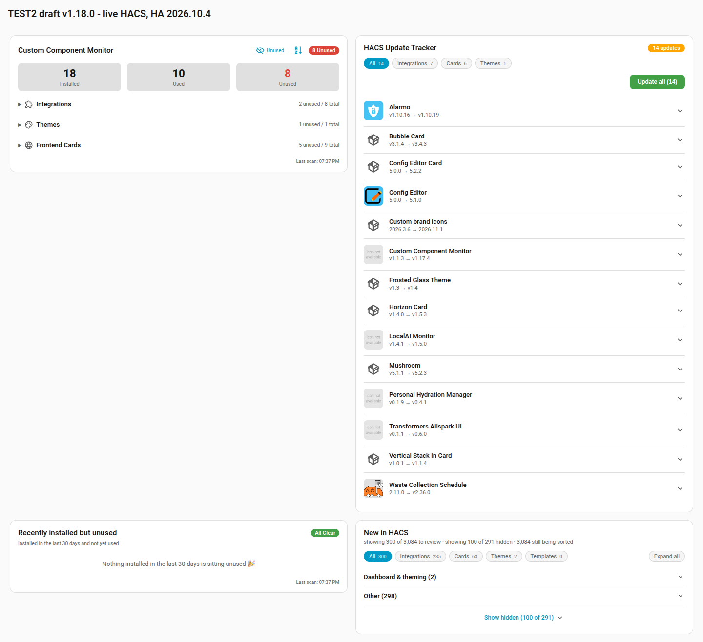
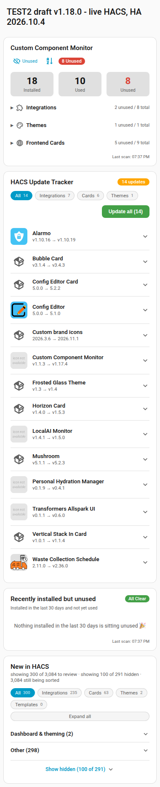

# Draft v1.18.0 - current and older Home Assistant verification

The same unpublished v1.18.0 package was installed on TEST1 with Marketplace
and TEST2 with legacy HACS on 9 November 2026. Counts recovered, targeted review
decisions survived restart, and the tested items were restored. Production was
not changed. This is draft-asset installation evidence, not a published HACS
upgrade or a clean-log certification.

## Package identity

- Release commit and canonical tag: `c0e8a6f7ac837295ac36546fc99f8d00fb8fc554`,
  `v1.18.0` (merged PR #107).
- Package: `custom_component_monitor.zip`, 266,947 bytes, 20 files.
- SHA-256: `e77a9dd1b07cc37bb61d71baee48651a146262b918c972761cbe9a1d88db4855`.
- Gitea draft release 473 / asset 228 and GitHub draft release 438687598 /
  asset 725974916 identify the same package. The downloaded installation zip and
  the canonical attachment have the same hash. Every archive file was compared
  with the release tag and matched exactly; no generated Python caches ship.
- Both releases were checked again as drafts on 9 November 2026. Neither was
  published. This documentation does not retag or rebuild the tested package.
- After a separately approved publication, download the workflow-produced asset
  again and compare its complete file set and each file's contents against this
  tag. Record its new archive hash: rebuilding a zip can change archive metadata
  without changing the packaged files. The draft hash is not evidence about a
  future published download.

Canonical draft:
<https://gitea.strant.casa/loryanstrant/HA-CustomComponentMonitor/releases/tag/v1.18.0>

GitHub draft (authenticated maintainer access required):
<https://github.com/loryanstrant/HA-CustomComponentMonitor/releases/tag/untagged-8e30b0179fb07af93436>

## Observed results

| Check | TEST1 | TEST2 |
| --- | --- | --- |
| Home Assistant | 2026.11.0 | 2026.10.4 |
| Active provider | Marketplace | HACS 2.0.5 |
| Installed-component sensor | 0 before draft, 17 after | 18 after recovery and draft installation |
| Update sensor | 0 before draft, 12 after | 14 |
| Review synchronization | Targeted dismiss/restart/restore passed | Targeted dismiss/restart/restore passed after startup settled |
| Review flags compared | 6,196 Marketplace flags | 6,191 existing HACS flags |
| Served cards | All four matched the draft package | All four matched the draft package |
| Browser sizes retained | 1440px and 380px | Verified 1440px and 380px replacement captures |
| Final lifecycle | Stopped | Stopped; remains pinned to 2026.10.4 |

Counts are snapshots, not fixed catalogue expectations. No component update,
installation or removal was triggered by the review and browser checks.

### TEST1: current Marketplace

The attached draft asset was downloaded and installed rather than copying the
working tree. Existing sensor IDs were retained. The installation-date seed
stayed `2026-07-31T12:24:20.240583+00:00` across the review round trip.

The review test dismissed `homeassistant-ai/ha-mcp` through the monitor service.
Only that repository's New flag changed among all 6,196 exposed flags, and the
review count fell from 3,247 to 3,246. After restart, the entire expected flag
map persisted. Restoring the target returned the original flag map and count,
with zero pending synchronization operations.

The saved update sensor contains 12 repository updates, while both tracker
screenshots show 11 actionable updates. The saved Atmospheric Weather Card
update record lacks an `entity_id`; the remaining 11 records have one. The
tracker's entity-ownership checks are covered by the existing regression test.
This report records the sensor/card distinction rather than claiming the
screenshots show 12. End-to-end actionability of the twelfth record remains
unverified; a live update installation was not attempted.

### TEST2: older HACS

TEST2 was pinned below 2026.11.0 through its Dockhand stack. Its newer config
could not provide a usable older-version frontend, so the requested Duplicati
snapshot from **24 October 2026 at 08:49 AEDT** was restored into a separate
staging directory before recovering TEST2. The pre-downgrade config was retained
for rollback; this was not a fresh blank installation. DEV and TEST1 were not
silently downgraded.

The recovered instance ran HA 2026.10.4 with HACS 2.0.5 and the same attached
draft package. On startup the monitor reported HACS starting, then recovered
live counts without a monitor reload. The install-date seed on this recovered
tester was `2026-11-09T03:29:24.719024+00:00` and stayed unchanged during the
settled persistence test. This proves stability of that seed during the test,
not retention of an October installation-date history that was not present.

The first attempted targeted test overlapped country-hide startup processing:
201 flags changed. **That attempt was rejected as targeted-only evidence.**
Two unchanged readings established a settled baseline before repeating the
reversible check for `koosoli/ESPHomeDesigner`:

1. Restoring the initially tested item changed only its flag to New.
2. Dismissing it changed only that flag and reduced the review count from
   3,081 to 3,080; synchronization had no pending work or last error.
3. Restart preserved the complete map of 6,191 flags exactly.
4. Restoring it again left every existing baseline flag unchanged. Three newly
   discovered catalogue records were recorded separately, not treated as
   unrelated-flag mutations; the final review count was 3,084.

The three additions were `chiconws/homeassistant-nanokvm`,
`constantini-ha/intelbras_dvr`, and `jasonmx/hue-smooth-dimming`.

## Browser verification

The four served modules were loaded in the authenticated testers using their
live sensor data and a temporary browser-only two-column/phone layout. No
Lovelace dashboard configuration was saved. TEST2's Cards filter selected six
updates; returning to All showed 14, with the shown update entities verified as
HACS-owned. Update/install buttons were not activated.

An earlier TEST2 screenshot had a loading splash, and its later desktop retake
was only 800px wide despite the filename. Neither is accepted as desktop
verification. The replacement capture measured `innerWidth` and document width
inside the same browser call, asserted 1440px and 380px, and checked body/card
horizontal overflow. The PNG widths were independently checked with Pillow.
All four cards fit at both sizes, and the 14-update badge and controls were
visible. A delegated image review agreed after the invalid captures were
replaced. This does not diagnose or claim to fix routed-browser continuity.

### TEST1 - Marketplace, 1440px and 380px

### TEST2 - HACS, measured 1440px and 380px

## Limits and operational notes

- AI recovery is not certified. TEST1 reported its configured AI Task entity
  missing; TEST2 used its recovered configuration. Some Marketplace tracker
  images did not load. No AI or image-provider repairs are included here.
- The recovered TEST2 log includes the earlier failed newer-config downgrade,
  startup dependency errors, the expected HACS-starting retry, custom-component
  warnings, and a recorder statistics-unit warning. Later functioning counts
  and browser checks do not turn that history into a clean-log pass.
- This is an existing-config draft-asset install on both testers, not a new
  config-flow setup, a published-release workflow test, or HACS-UI installation
  automation. Expanded-row states, a full live country-hide matrix and
  concurrent upstream review failure injection remain outside this pass.
- Task backups remain on BLASTER under
  `/etc/docker/_component_backups/ccm-157a-1.18.0/test1` and
  `/etc/docker/_component_backups/ccm-157a-1.18.0/test2`, including
  `test2/config-before-downgrade.tar`. The separate Duplicati recovery stage is
  `/etc/docker/Duplicati/restore-test2-157a-oct24`. These are local rollback
  copies, not an assertion of additional off-host backups.
- TEST1 and TEST2 were stopped through Dockhand after testing. A final state
  check confirmed DEV, TEST1 and TEST2 all exited. TEST2's requested 2026.10.4
  pin remains; no production instance was changed and no release was published.

## Evidence provenance

Retained in Rufus session `157a702533c8`, under `_IMAGES/release-1.18.0`:
`test1-live.json`, `test1-review-evidence.json`, `test2-review-evidence.json`,
the TEST2 baseline/dismissed/restarted/restored flag maps, served-file comparison
results in the transcript, and the accepted screenshots copied beside this
report. Raw config, backup credentials and full container metadata are not
committed. Earlier candidate/unit-test evidence remains in
[marketplace-1.18.0.md](marketplace-1.18.0.md); its pre-release gaps describe that
earlier pass and are superseded only where this report supplies later evidence.
