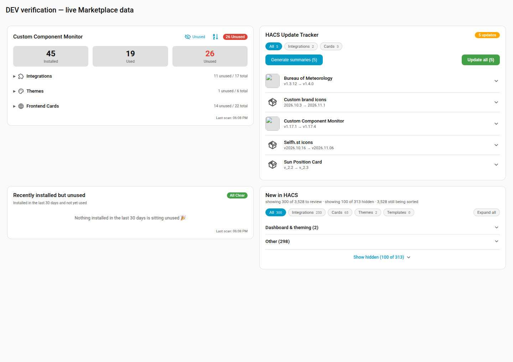
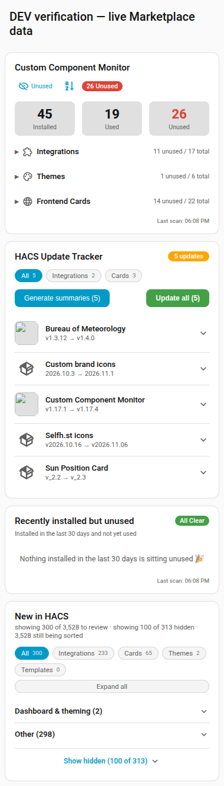
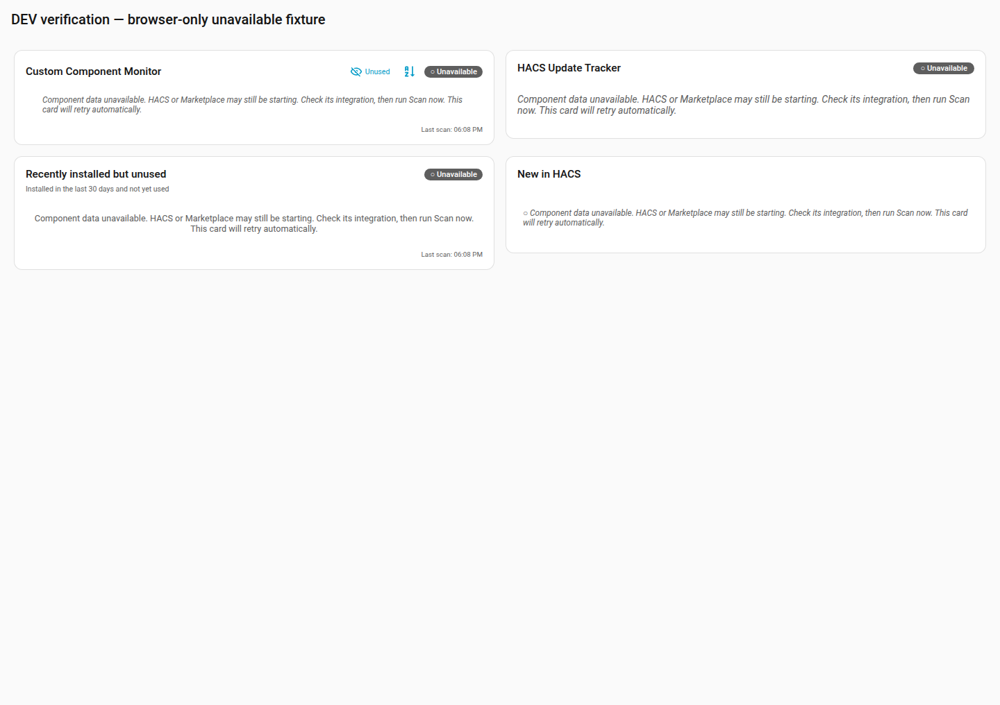
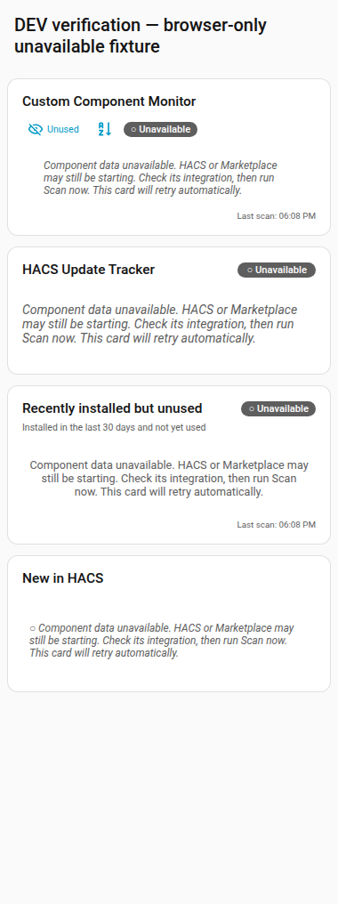

# HACS / Marketplace compatibility - v1.18.0 verification

Verified on 9 November 2026, approximately 12:43-13:20 AEDT, in Rufus session
`157a702533c8`. Production was not changed. This is candidate verification, not a
published-release install test.

## Results

| Check | Result |
| --- | --- |
| Python regression suite | 538 passed; HA 2025.1.4, pytest-homeassistant-custom-component 0.13.205, pytest 8.3.4 |
| Candidate Hassfest | 1 integration, 0 invalid integrations |
| JavaScript syntax and ownership tests | All four modules parse; `node tests/test_tracker_card.cjs` passed |
| Targeted Ruff and whitespace checks | `ruff check custom_components/custom_component_monitor/store.py tests/test_store.py` and `git diff --check` passed |
| HACS Action | All 10 repository checks passed against the public mirror's `main`, not the unmirrored candidate branch; no integration categories declared warning |

The full Python gate is `python -m pytest -q`. The test environment is the repo's
persistent venv, not a new dependency set. Marketplace runtime objects are shaped
fixtures in the older-HA suite; the live Marketplace check below covers the actual
2026.11.0 contract. No newer HA module is imported by the compatibility adapter.

## Live DEV evidence

HomeAssistant-DEV on BLASTER was confirmed running HA 2026.11.0 through Dockhand
and its API. TEST1 and TEST2 were stopped and were not started for this final pass.
The previous component was backed up outside `custom_components` before the
candidate was copied. The task rollback copy remains in BLASTER's
`/tmp/ccm-157a702533c8/backup/custom_component_monitor` (temporary, not a durable backup).

| Existing sensor | Before candidate | After candidate / restart |
| --- | --- | --- |
| `sensor.hacs_installed_components` | 0 | 45 |
| `sensor.unused_custom_integrations` | 0 | 11 |
| `sensor.unused_custom_themes` | 0 | 1 |
| `sensor.unused_frontend_resources` | 0 | 14 |
| `sensor.hacs_updates` | 0 | 5 |
| `sensor.hacs_new_items` | 0 | 3,528 |

All six expose `component_provider: marketplace`. Review synchronization reports
zero pending operations and no last error. Existing entity IDs stayed unchanged.
The installation-date tracking seed stayed unchanged across the candidate scan,
dismissal, restart and restoration.

The targeted persistence check read all 6,199 Marketplace repository New flags
through `marketplace/repositories/list`, dismissed `homeassistant-ai/ha-mcp` via the
monitor's own service, and asserted that only its flag changed. The visible count
fell from 3,528 to 3,527. After a Dockhand DEV restart at approximately 13:07 AEDT,
the complete flag map still matched that expected result. Restoring the same item
returned all 6,199 flags to their original values and the count to 3,528. No
repository was installed, updated or removed by this test.

DEV logs show the monitor reporting Marketplace startup at 13:08 AEDT, then the
API and browser show recovered counts without a monitor reload. This exercises
the unavailable-then-retry path, not merely an already-ready startup. The logs also
show the configured DEV AI endpoint failing DNS lookups and AI work remaining
pending; this change does not repair or validate that endpoint. Other installed
components emit their own warnings; this is not a clean-log claim.

## Browser checks

The real deployed card modules were mounted temporarily in the authenticated DEV
frontend with live sensor data. No Lovelace dashboard configuration was saved.
All four decompressed `/local/custom_component_monitor/*.js` responses were compared
byte-for-byte with the final worktree after the narrow-header fix.

1. Captured desktop at 1440px and phone at 380px. Measured no card horizontal
   overflow or clipped title after fixing header wrapping.
2. Exercised review kind filters, Expand all and cancel-only Dismiss all
   confirmation. Exercised the tracker Cards filter, showing three selected
   updates, and checked update ownership against `entity/source`.
3. Checked the install link targets `/marketplace/repository` and reaches the
   Marketplace panel. Its community-code safety agreement was deliberately not
   accepted, so the repository download dialog behind that agreement is unverified.
4. Tested unavailable rendering with browser-only cloned sensor states. All four
   cards display unavailable text instead of zero/all-clear. Backend unavailable
   and automatic-recovery behavior is also covered by the Python tests and the
   real DEV restart; browser fixtures do not pretend to be live service failures.
5. A delegated visual review identified the narrow title clipping, which was
   fixed and recaptured. It also noted missing remote update images; their loading
   is outside this compatibility fix. The review card communicates unavailable in
   its existing message area rather than adding a new header-badge design.

The routed browser lost page continuity between tool calls: a standalone screenshot
returned `about:blank`, and that image was rejected. Usable captures put navigation,
authentication, rendering and screenshots in one `browser_run_code_unsafe` call,
then immediately retrieved the files into this worktree. This does not claim the
shared browser continuity problem is fixed.

### Live data - desktop and phone

### Browser-only unavailable fixture - desktop and phone

## Compatibility boundaries and remaining checks

- Configured Marketplace remains authoritative even when disabled or unavailable.
  A disabled leftover Marketplace entry therefore does not silently reactivate
  retired HACS data; remove the retired Marketplace configuration when deliberately
  reverting to legacy HACS. Unknown private contracts fail unavailable.
- Both HACS and Marketplace-owned update entities remain eligible, as approved;
  core and unrelated owners are excluded. Simultaneously running both managers for
  the same repository is not a supported migration mode and was not exercised live.
- The review writer is the active manager's own awaited writer, with durable local
  retry intent and targeted rollback tests. This is not a transaction across the
  monitor, Marketplace and independent concurrent Marketplace actions; partial
  persistence plus an upstream dispatch failure is not fault-injected live.
- Legacy HACS version-six storage and review behavior are covered offline; no older
  HA/HACS instance was started. A published-release install on TEST1/TEST2, full
  live country-hide/restore matrix and AI-provider recovery remain pre-release checks.
- Existing lists and their sort/filter conventions are retained: monitor alphabetical
  by default, recent unused newest first, tracker alphabetical, review newest within
  alphabetical category groups. No search/sort redesign or separate mobile app is
  part of this bug fix; the same responsive Lovelace modules serve phones.

No merge, tag or release was performed. DEV lifecycle cleanup is reported in the
pull request and session completion message after verification.
