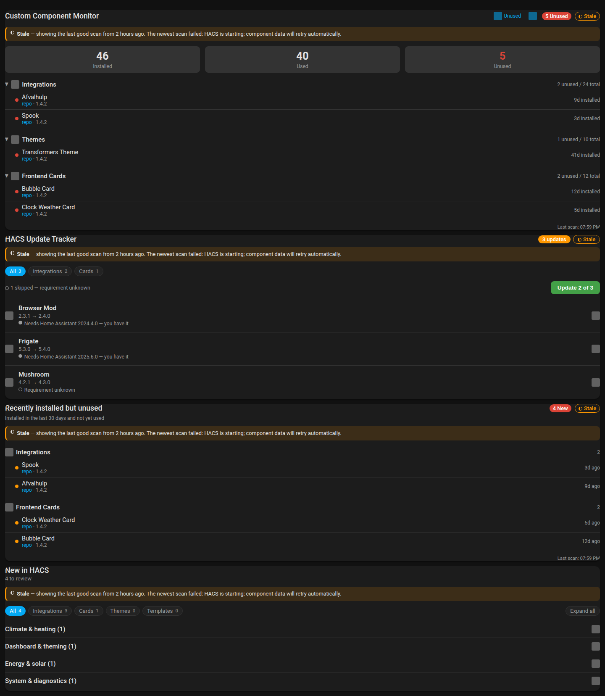
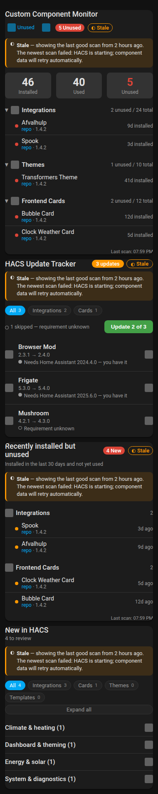

# Stuck store / stale data - v1.20.0 verification

Verified on 14 November 2026, approximately 08:50-17:00 AEDT, in Rufus session
`f1a30679a824`. **Production was read, never changed**: no `.storage` edit, no
service call, no reload and no restart. No DEV or TEST instance was started.
This is candidate verification, not a published-release install test.

## Results

| Check | Result |
| --- | --- |
| Python regression suite | 591 passed; HA 2025.1.4, pytest-homeassistant-custom-component 0.13.205, pytest 8.3.4 |
| JavaScript syntax | `node --check` passed on all four `www/*.js` modules (Node v22.23.4) |
| Card ownership / stale / unavailable tests | `node tests/test_tracker_card.cjs` passed, including the new stale assertions |
| Card compatibility tests | `node tests/test_tracker_card_compat.cjs` passed |
| Version strings | `manifest.json` and all four `CARD_VERSION` constants read `1.20.0` |

The full Python gate is `python -m pytest -q` against the repo's persistent venv.
There is no lint gate in this repo (AGENTS.md).

Hassfest and the HACS Action were not run. They live in `validate.yaml`, which is a
GitHub Actions workflow; the pull request is on Gitea, where Actions is switched off
for this repository entirely. The branch is also **not on the GitHub mirror** - listing the
mirror's branches shows `main` at the same commit as Gitea's `main`, and no
`claude/f1a30679a824-*` ref - so neither check can have run yet. They first run on
`main` after the merge is mirrored.

What was checked locally instead: the only change this branch makes to a file those
two checks look at is the version string, `1.19.0` to `1.20.0` in `manifest.json`
(`hacs.json` is untouched). Both files parse, the manifest carries every key hassfest
requires, `iot_class` is a valid value, the keys are still in the expected order, and
`hacs.json`'s `filename` still matches the asset name `release.yaml` uploads.

## Live production evidence (read-only)

The fault was diagnosed on the live instance before anything was written. All of
this is observation; nothing was mutated.

| Observation | Evidence |
| --- | --- |
| All six monitor sensors `unavailable` since 08:21:49 AEDT | `GET /api/states` |
| Every scan failing with the same message | `home-assistant.log`: *"Hacs is starting; component data will retry automatically"*, 65 occurrences in the first 32 minutes |
| HACS never reaching its running stage | the log shows `setup`, `waiting` and `startup` only, for the whole uptime |
| HACS's own storage file complete and correct throughout | `.storage/hacs.repositories` held 6,454 repository rows |
| The trigger | two rows for `Joery/hass-afvalhulp` - the only duplicate in 6,454 |

That duplicate makes HACS 2.0.5's `set_repository_id` raise out of its startup
tasks *after* `status.startup` is cleared and *before* the running stage is set,
so the stage stays `startup` permanently. Upstream state was checked: HACS 2.0.5
is the current release, PR hacs/integration#5463 was closed unmerged on
16 October 2026, and issues #5461 and #5480 were closed as completed with
"fixed in Marketplace, which ships with Home Assistant 2026.11". There is no
HACS-side fix to wait for on this version.

## Offline card rendering

The four real card modules were loaded in a static harness with a stubbed `hass`
whose six sensors carry the new scan-health attributes (`data_stale: true`,
`last_successful_scan` two hours back, the production `scan_error` text, and a
`store_status` of `stage: "startup", starting: true`). The harness is scratch and
is not committed; it lives in the session worktree's `_IMAGES/`.

Served from the Rufus container on `0.0.0.0:8703` and captured through the shared
Playwright browser at the two sizes this repo's `.agent/screens.yaml` declares -
desktop 1440x1000 and phone 380x800, and no others.

Checked in the images below:

1. All four cards keep their counts and lists, and none shows **Unavailable**.
2. Each card carries the stale notice: *"◐ **Stale** - showing the last good scan
   from 2 hours ago. The newest scan failed: HACS is starting; component data will
   retry automatically."*
3. The three cards with a header badge row also show an outlined **◐ Stale** badge
   beside the count badge. The mark is a drawn half-filled shape plus the word, so
   nothing depends on telling colours apart (house rule 11).
4. At 380px the notice wraps to three lines inside the card, the badge stays on the
   header row, and no card overflows horizontally.
5. The quoted error reads "HACS", not "Hacs" - the store now spells the provider the
   way the brand does rather than using `domain.title()`.

The browser was driven over raw JSON-RPC against the Playwright endpoint because the
Rufus tool router returned `RuntimeError` on every discovery call this turn. The
browser service itself was reachable and answered normally; the shared browser was
not closed.

### Stale state - desktop

### Stale state - phone

## Behaviour covered by the Python suite

- A failed scan with datable last-good data keeps the coordinator **successful**,
  so the entities stay available and the cards render; the data is flagged stale.
- A failed scan with no `last_successful_scan` marker - a cold start, or an upgrade
  from a version that never wrote one - still fails honestly to unavailable.
- Stale data expires after 24 hours (`SCAN_STALE_GRACE`), after which the sensors do
  go unavailable.
- Retry backs off 30s, 1m, 2m up to the ordinary hourly interval, and resets on the
  first success. The identical failure is logged once, not twice a minute.
- Install dates, dismissals and to-do history are untouched by a failed scan.
- A HACS stuck on `startup` or `setup` now has its storage file read; an *empty* file
  mid-startup is still refused, because publishing zero components would read as
  "everything was uninstalled".
- Writing to a starting provider's live objects is still refused - relaxing the gate
  applies to reading a file, not to review syncing.

## Remaining checks and limits

- **Not verified on a live stuck HACS.** The stuck condition is reproduced as a test
  fixture and as a card fixture, not by holding a real HACS in that state. The live
  instance that showed the fault was only read.
- **No live instance ran this candidate.** DEV, TEST1 and TEST2 were not started;
  they belong to the HA development workflow, not to this session.
- **No published-release install test.** Installing 1.20.0 from the release and
  confirming the cards recover on the real stuck instance is the post-release check,
  and is the user's own install.
- **Hassfest and the HACS Action have not run.** They are GitHub-side workflows and the
  branch has not reached the mirror; check them on `main` after the merge is mirrored.
  The metadata they validate was checked by hand instead, as described above.
- Other installed components emit their own warnings in the production log; nothing
  here claims a clean log.

No merge, tag or release was performed at the time of writing.
