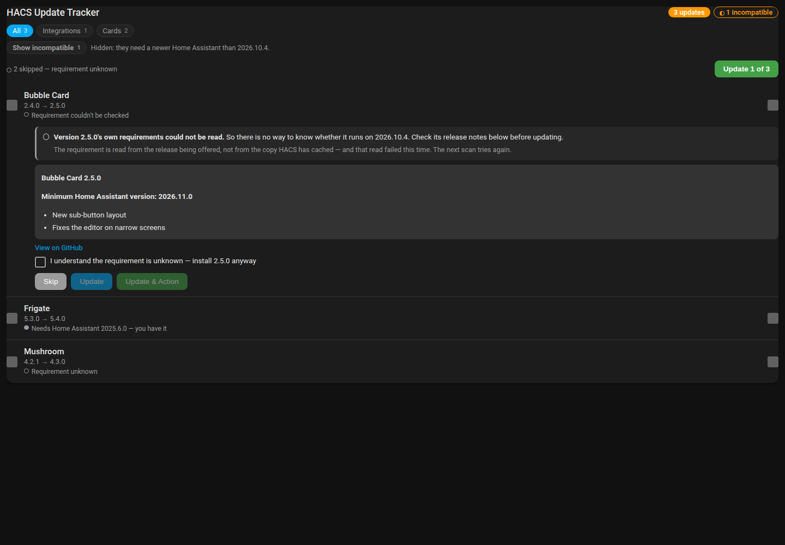
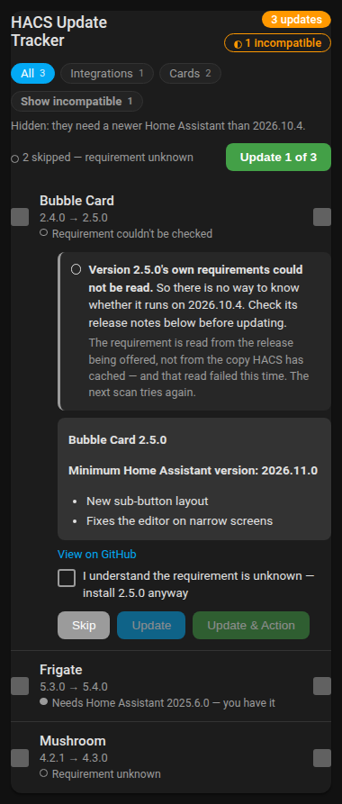

# Offered-release requirement check - v1.21.0 verification

Verified on 14 November 2026, approximately 18:30-20:30 AEDT, in Rufus session
`f1a30679a824`. **Production was read, never changed**: no `.storage` edit, no
service call, no reload and no restart. No DEV or TEST instance was started.
This is candidate verification, not a published-release install test.

## Results

| Check | Result |
| --- | --- |
| Python regression suite | 607 passed; HA 2025.1.4, pytest-homeassistant-custom-component 0.13.205, pytest 8.3.4 |
| JavaScript syntax | `node --check` passed on all four `www/*.js` modules (Node v22.23.4) |
| Card ownership / stale / unavailable tests | `node tests/test_tracker_card.cjs` passed |
| Card compatibility tests | `node tests/test_tracker_card_compat.cjs` passed, including the rewritten failed-read section |
| Version strings | `manifest.json` and all four `CARD_VERSION` constants read `1.21.0` |

The full Python gate is `python -m pytest -q` against the repo's persistent venv.
There is no lint gate in this repo (AGENTS.md). 16 of those 607 tests are the new
`tests/test_verify_update_requirements.py`.

Hassfest and the HACS Action were not run, for the same reason as 1.20.0: they live
in `validate.yaml`, a GitHub Actions workflow, and the pull request is on Gitea where
Actions is switched off for this repository. The branch is not on the GitHub mirror,
so neither check can have run. They first run on `main` after the merge is mirrored.
The only file this branch changes that those checks read is `manifest.json`, and the
only change in it is the version string `1.20.0` to `1.21.0`; `hacs.json` is untouched.

## Live production evidence (read-only)

The fault was reported from the production card and confirmed against the live
instance before anything was written. All observation; nothing mutated.

| Observation | Evidence |
| --- | --- |
| The card claimed a compatible update that its own release notes contradict | `update.ms365_calendar`, v1.13.0 to v1.14.0: the row read "Needs Home Assistant 2025.6.0 - you have it" while the release notes rendered below it in the same card said minimum 2026.11.0 |
| The stated requirement was the **installed** release's | `2025.6.0` is MS365-Calendar v1.13.0's `hacs.json` minimum; v1.14.0's is `2026.11.0` |
| HACS stores one manifest per repository, with nothing recording its release | `.storage/hacs.repositories` - each row has a single `repository_manifest`, no version field beside it |
| HACS's catalogue feeds carry no minimum at all | 0 of 6,279 catalogue rows publish a `homeassistant` key, so there is no second source to fall back on |
| The header's count was wrong by the same mechanism | "7 updates / 2 incompatible"; the true count was 3 |

Upstream state was checked rather than assumed: HACS 2.0.5's own install gate has the
same blind spot (`repositories/base.py` compares against the stored manifest regardless
of which release is being installed), and hacs/integration#4652, which fixes it, merged
on 10 June 2025 and has never appeared in a release. Home Assistant 2026.11's built-in
Marketplace checks the offered release correctly. So there is no upstream fix to wait
for on the version in use.

## The fetch, checked against the live production updates

The one thing a mocked test cannot settle is whether the URL this builds resolves
for real repositories. It does, for all seven pending updates on the production
instance. Checked 14 November 2026 at approximately 20:30 AEDT by reading the
`update.*` entities (read-only) and fetching each manifest directly.

The tag is taken from the entity's `latest_version` **verbatim**, and that turns out
to be load-bearing: HACS reports the GitHub tag, prefix included, and the prefix is
not consistent across repositories. `update.microsoft_365_calendar_update` reports
`v1.14.0`; `update.device_card_update` reports `2.1.0`. Normalising either way would
404 half of them.

| Repository | Offered tag | Fetch | Declares |
| --- | --- | --- | --- |
| `RogerSelwyn/MS365-Calendar` | `v1.14.0` | 200 | 2026.11.0 |
| `homeassistant-extras/device-card` | `2.1.0` | 200 | 2026.11.0 |
| `skye-harris/hass_local_openai_llm` | `1.15.1` | 200 | 2026.11.0 |
| `acosta290/fluvy` | `v1.20.0` | 200 | 2026.9.0 |
| `Mastershort/neonplan3d` | `v3.2.0` | 200 | 2025.1.0 |
| `Matysh/houseplan-card` | `v1.85.2` | 200 | 2024.6.0 |
| `teuchezh/dynamic-weather-card` | `v2026.11.2` | 200 | 2024.1.0 |

7 of 7 answered, so the `target_unreadable` path is the exception it is designed to
be rather than the common case. `v1.14.0`'s manifest declares `"homeassistant":
"2026.11.0"` — the value the card should have been showing — while `1.14.0` without
the prefix returns 404, which is why a 404 is treated as "could not read" and never
as "declares nothing".

Production runs **core-2026.10.4** (Home Assistant Container; HACS 2.0.5, stage
`startup`), so the true verdict for those seven is **3 blocked, 0 unknown**. Read at
the same moment, `sensor.hacs_updates` published `updates_blocked: 2`,
`updates_unknown_requirement: 0` from a scan that had succeeded minutes earlier — the
fault still live, under-reporting by exactly one, which is the discrepancy originally
reported. After 1.21.0 is installed the header should read **3 incompatible**.

(Incidentally the same read confirms 1.20.0 working: HACS is still stuck on `startup`
and the sensor nevertheless carries a fresh successful scan with `data_stale: false`,
because the relaxed gate now reads the storage file rather than the status flag.)

## Offline card rendering

The real `update-action-tracker-card.js` module was loaded in a static harness with a
stubbed `hass` at Home Assistant 2026.10.4 and four update rows - one `blocked`
(2026.11.0), one `met`, one `not_declared` unknown, and one `target_unreadable`
unknown with release notes that state a 2026.11.0 minimum, reproducing the shape of
the production fault. The harness is scratch and is not committed; it lives in the
session worktree's `_IMAGES/`.

Served from the Rufus container on `0.0.0.0:8704` and captured through the shared
Playwright browser at the two sizes this repo's `.agent/screens.yaml` declares -
desktop 1440x1000 and phone 380x800, and no others. The server was stopped afterwards
and the shared browser was not closed.

Checked in the images below:

1. The failed-read row reads **"○ Requirement couldn't be checked"** - not "met", and
   not the old release's requirement restated as fact.
2. Expanding it shows *"Version 2.5.0's own requirements could not be read. So there is
   no way to know whether it runs on 2026.10.4. Check its release notes below before
   updating."* and, beneath that, *"The requirement is read from the release being
   offered, not from the copy HACS has cached - and that read failed this time. The
   next scan tries again."*
3. The release notes rendering directly below that panel say minimum 2026.11.0, and
   nothing above them now contradicts it - which is the exact disagreement that was
   reported.
4. Installing anyway is still possible but deliberate: the row is excluded from the
   bulk selection (the button reads **Update 1 of 3** with **"2 skipped - requirement
   unknown"**) and its own Update button stays disabled until *"I understand the
   requirement is unknown"* is ticked.
5. The `blocked` row is held behind **Show incompatible 1** with the explanation
   *"Hidden: they need a newer Home Assistant than 2026.10.4."*
6. Every verdict is a drawn shape plus words - `●` met, `◐` blocked, `○` unknown - so
   nothing depends on telling colours apart (house rule 11).
7. At 380px the new two-sentence headline, the why-line and the checkbox label all wrap
   inside the card, and nothing overflows horizontally.

### Compatibility verdicts - desktop

### Compatibility verdicts - phone

## Behaviour covered by the Python suite

- The requirement is read from the **offered** release's `hacs.json`, fetched at that
  release's ref, not from HACS's stored snapshot.
- A successful read is cached for the life of the running Home Assistant, keyed by
  repository **and** version, so a newly-offered version is always re-read and a
  version already answered costs nothing. The cache is pruned when a row disappears.
- **A failed read is never cached**, so the next hourly scan retries it.
- **A failed read never reads as compatible.** It resolves to an unknown with reason
  `target_unreadable`, and `strictest()` keeps an already-known `blocked` ahead of it -
  so an unknown can never overwrite a known incompatibility with a green tick.
- A body too large to be a manifest, and bytes that are not text, are both treated as
  failed reads rather than parsed optimistically.
- The whole pass is bounded: 10s per request, 25s for the pass as a whole, 4 requests
  in flight, 256 KB read per response. Work still pending at the budget is cancelled
  and those rows become failed reads.
- The counts the card's header uses (`updates_blocked`, `updates_unknown_requirement`)
  are recomputed after the verification pass, not before it.

## Release outcome

Released on 14 November 2026 at 8:45pm AEDT, on the owner's go-ahead for both the
merge and the release.

| Step | Result |
| --- | --- |
| Pull request 115 merged to Gitea `main` | `8154925`, merge commit |
| Tag created **in Gitea first** | `v1.21.0` at `8154925` |
| Gitea release published | canonical parity, same notes |
| Push mirror synced | GitHub `main` and `refs/tags/v1.21.0` both resolve to `8154925` |
| GitHub release published against the existing tag | release 445187606, not a draft, marked latest |
| `release.yml` | completed/success; `custom_component_monitor.zip` attached, 291,291 bytes, state `uploaded` |
| `validate.yml` on the tag | **HACS Validation success, Hassfest Validation success, Tests success** |

The tag was created in Gitea before the GitHub release, so the 8-hourly prune-mode
mirror keeps it rather than deleting it and drafting the release with it.

The published zip was downloaded and opened rather than trusted: it unpacks to the
*contents* of `custom_components/custom_component_monitor/` (16 entries, no
`__pycache__` and no `.pyc`), `manifest.json` and all four `CARD_VERSION` constants
read `1.21.0`, `sensor.py` carries `async_verify_update_requirements`, `const.py`
carries `TARGET_MANIFEST_URL`, and `target_unreadable` is present in both `compat.py`
and `update-action-tracker-card.js`. So the artefact HACS will install is the fix.

Hassfest and the HACS Action, listed as pending above, have now run on the tag and
both passed — that limit is closed.

## Remaining checks and limits

- **The network cost is real and is the trade-off here.** The hourly refresh is also
  awaited by config-entry setup and by the install services when they meet an update
  the last scan had not seen, so with GitHub unreachable the 25s pass budget is the
  worst-case stall on starting up and on pressing Update. That is why the budget is
  short; it is recorded in `DECISIONS.md` rather than left as a surprise.
- **Not verified against live GitHub rate limiting.** The fetches are unauthenticated
  `raw.githubusercontent.com` reads, one per newly-offered update. A house with a very
  large number of simultaneous updates has not been observed against the real endpoint.
- **No live instance ran this candidate.** DEV, TEST1 and TEST2 were not started; they
  belong to the HA development workflow, not to this session.
- **No published-release install test.** Installing 1.21.0 from the release and
  confirming the Microsoft 365 - Calendar row flips to incompatible on the production
  instance is the post-release check, and is the owner's own install. The expected
  result is a header reading **3 incompatible** rather than today's 2, with Microsoft
  365 - Calendar, Device Card and Local OpenAI LLM all held back.
- **Hassfest and the HACS Action have now run and passed** on the `v1.21.0` tag - see
  *Release outcome* above.
